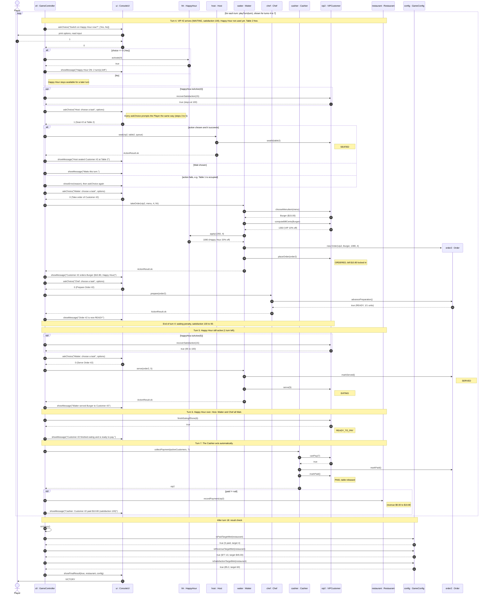

# Sequence diagram: VIP Customer #2 in the Stage 3 victory run (turns 4 to 7)

Source run: [`docs/test-runs/stage3-victory.txt`](../test-runs/stage3-victory.txt).
Open [`vip2-sequence.html`](vip2-sequence.html) in a browser to view it full size and download it as SVG or PNG.

## What the diagram shows

This diagram follows VIP Customer #2 through the **Stage 3** victory run, from arrival on turn 4 to payment on turn 7. At the start of turn 4, #2 joins the queue with satisfaction 100. Happy Hour has not been used yet, Table 1 is held by Customer #1 (ready to pay), and Table 2 is free. The player switches on Happy Hour. While it is active, the controller lets waiting customers recover satisfaction (the `opt [happyHour.isActive]` frame). The Host seats #2 at Table 2, the Waiter takes the order, and the Chef finishes the one-unit Burger, all on turn 4. The price is set when the order is taken: the VIP gets 10% off the $15.00 Burger ($13.50), then Happy Hour takes another 20% off, so a bill of **$10.80** is locked into the `Order`. On turn 5 the Waiter serves it, and recovery brings #2 back from 95 to 100. On turn 6 #2 finishes eating and becomes `READY_TO_PAY`. On turn 7 the Cashier automatically collects $10.80, which raises revenue from $9.00 to $19.80. **Outcome:** #2 pays at full satisfaction (100), and the run ends in **VICTORY** with 5 paid, $77.10 revenue and 85.2 average satisfaction, meeting all three targets.

The `GameController` drives every step. Each turn it calls the staff in a fixed order (Happy Hour, Host, Waiter, Chef, then eating and payment). Each staff step builds a list of options and asks the player through `ConsoleUI.askChoice()`. The `alt` frame shows what happens next: a successful action prints its message, "Wait" skips the turn, and a failed action (such as seating at an occupied table) shows the staff member's reason and asks again. The staff objects only change state through `Customer` and `Order` methods (`seatAt`, `placeOrder`, `advancePreparation`, `serve`, `markPaid`), so the customer moves through WAITING, SEATED, ORDERED, EATING, READY_TO_PAY and PAID, and the order through IN_PREPARATION, READY, SERVED and PAID. The `HappyHour` object is used in two places: the controller checks it for recovery, and the Waiter uses it for the discounted price. After the last turn, `isVictory()` checks each target in `GameConfig` and `ConsoleUI.showFinalResult()` prints the result.
